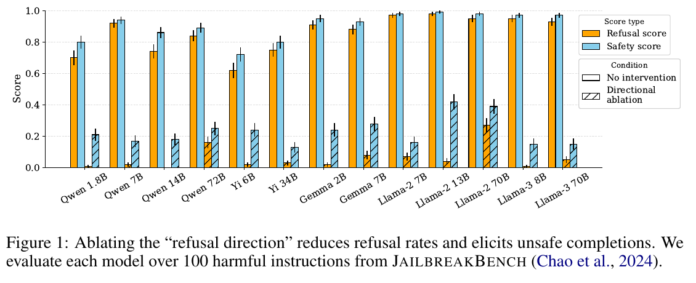

# Capstone (with GPU) — reproduce a paper result

## The task

Reproduce the main effect of
[**Refusal in Language Models Is Mediated by a Single Direction**](https://arxiv.org/abs/2406.11717)
(Arditi et al., 2024) on a model of your choice. The paper is in `paper/refusal_single_direction.pdf`.

The claim: take the difference in mean residual-stream activations between harmful
and harmless instructions, and you get a single "refusal direction". Ablating that
direction from the model's activations makes it stop refusing harmful requests
(refusal score drops), and the completions become unsafe (safety score drops).

Pick a small open-weights chat model (e.g. Qwen 1.8B/7B, Gemma 2B, Llama-3 8B — or a
newer one) and show the same effect: refusal score and safety score on harmful
instructions, with and without directional ablation, as a Figure 1-style bar plot.

**Done when:** you have a plot like Figure 1 for your model, produced by an experiment
in `experiments/` that follows the repo conventions (`AGENTS.md`).

## Setup

This branch is the bare project template: `lib/`, `AGENTS.md`, and the
`research_scaffold` config system. Nothing is built yet — you decide the design.
You need a GPU for this one.
